<div align="center">
<h3>ドローンエンジニア養成塾 デベロッパーコース</h3>
<h2>コンパニオンコンピュータ（BlueOS）環境構築手順書</h2><br>
(Raspberry Pi 5 + BlueOS)<br/>
Ver.1.1.0 - 2026.11.17
</div>

<!--
Ver.1.0.0 - 2026.6.12 - 初版
Ver.1.1.0 - 2026.11.17 - 機体をBlueOS内蔵SITLに変更（3章再編、BlueOS 1.5.0-beta.43に変更）、Windows 11 前提に変更、構成図の差し替え、SSHホスト鍵エラーの対処を追加
-->

Table of Contents
<!-- @import "[TOC]" {cmd="toc" depthFrom=1 depthTo=6 orderedList=false} -->

<!-- code_chunk_output -->

- [1. はじめに](#1-はじめに)
  - [1.1. 実機導入の目的](#11-実機導入の目的)
  - [1.2. 本書の位置づけ](#12-本書の位置づけ)
  - [1.3. 前提事項](#13-前提事項)
- [2. ラズパイの初期セットアップ](#2-ラズパイの初期セットアップ)
  - [2.1. 事前準備](#21-事前準備)
  - [2.2. イメージのフラッシュ](#22-イメージのフラッシュ)
  - [2.3. 起動確認とセットアップ](#23-起動確認とセットアップ)
    - [2.3.1. 初回起動とホットスポット接続](#231-初回起動とホットスポット接続)
    - [2.3.2. セットアップウィザードの実行](#232-セットアップウィザードの実行)
    - [2.3.3. 接続確認](#233-接続確認)
  - [2.4. Pirate Modeの有効化](#24-pirate-modeの有効化)
  - [2.5. BlueOSのバージョン切り替え](#25-blueosのバージョン切り替え)
- [3. SITLの起動設定](#3-sitlの起動設定)
  - [3.1. SITLボードへの切り替え](#31-sitlボードへの切り替え)
  - [3.2. SITLファームウェアのインストールと起動](#32-sitlファームウェアのインストールと起動)
  - [3.3. Mission Plannerからの接続確認](#33-mission-plannerからの接続確認)
  - [3.4. 起動位置の設定（ドローンフィールドKawachi）](#34-起動位置の設定ドローンフィールドkawachi)
  - [3.5. 機体設定](#35-機体設定)
    - [3.5.1. 機体モデルの設定（sitl_frame）](#351-機体モデルの設定sitl_frame)
    - [3.5.2. フレーム設定](#352-フレーム設定)
    - [3.5.3. 加速度計のキャリブレーション](#353-加速度計のキャリブレーション)
  - [3.6. 飛行動作の確認](#36-飛行動作の確認)
- [4. Appendix](#4-appendix)
  - [4.1. 参考情報](#41-参考情報)
    - [4.1.1. BlueOS](#411-blueos)
    - [4.1.2. ArduPilot SITL](#412-ardupilot-sitl)
    - [4.1.3. Mission Planner](#413-mission-planner)
    - [4.1.4. Cockpit](#414-cockpit)
  - [4.2. （参考）実機FC（フライトコントローラー）を接続する場合](#42-参考実機fcフライトコントローラーを接続する場合)
  - [4.3. （参考）CockpitからのGCS接続確認（任意）](#43-参考cockpitからのgcs接続確認任意)

<!-- /code_chunk_output -->

<div style="page-break-before:always"></div>

## 変更履歴

| 日付 | バージョン | 変更箇所・理由 |
|------|-----------|--------------|
| 2026.11.17 | 1.1.0 | 機体をBlueOS内蔵SITLに変更（3章再編、BlueOSバージョンを1.5.0-beta.43に変更）、Windows 11 前提に変更<br>1章：構成図を差し替え<br>2.3.3節：SSHホスト鍵エラーの対処を追加 |

<div style="page-break-before:always"></div>

# 1. はじめに
本書はArduPilotドローンアプリケーション開発用コンパニオンコンピュータ環境を構築する手順書です。  
コンパニオンコンピュータとしてRaspberry Pi 5（以下、ラズパイ）、OSイメージとしてBlueOSを使用します。

機体の代わりとしてBlueOS内蔵のSITL（ArduPilotのシミュレータ）を使用します。BlueOS内蔵のMAVLink Serverが、機体のテレメトリをPC上のGCS（Mission Planner）や開発アプリに配信します。  
本書で構築する環境の構成は下記の通りです。

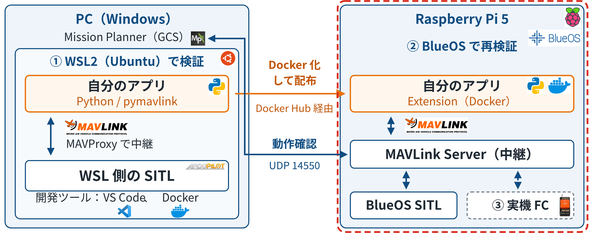

## 1.1. 実機導入の目的
コンパニオンコンピュータ実機を導入することで座学習の理解をより一層深めることを第一の目的としています。  
- それぞれの技術要素、ソフト、ツールが実機のどこで利用されるのか。
- 実機ならではの問題に遭遇し、それの対処法を考える。
- アプリ開発⇔実機テストのサイクルをスムーズに行える。
- 卒業後でも継続して開発、運用のために活用できる。

## 1.2. 本書の位置づけ
本書のゴールは、**BlueOS内蔵のSITLを起動し、PC側のMission PlannerからBlueOS経由で機体に接続できること**を確認するところまでです。

SITLをBlueOS内で動かすことで、PCとラズパイの間にSITL用の接続設定は不要になります。また、実機のフライトコントローラー（FC）を接続したときと同じ「機体 → BlueOS（MAVLink Server）→ クライアント」のデータフローのまま学習・開発ができます。

アプリ開発はすべてPC（WSL2）側で行い、ラズパイ上には開発環境を構築しません。  
BlueOSは「ホストOSには手を入れず、アプリはDockerコンテナ（Extension）として動かす」という設計思想のOSです。本書でもこの思想に沿って、ラズパイへのライブラリの直接インストールやVS Codeのリモート接続は行いません。

アプリの開発手順（pymavlinkによる開発、Docker化、BlueOS Extension化）は、アプリケーションコースのテキストで解説するので、本書では触れません。

※ トラブルシューティング等でラズパイ内のファイル確認やターミナル操作が必要な場合は、BlueOS管理画面の `File Browser` / `Terminal` をブラウザから利用できます。ただし `Terminal` で開くのはコンテナ内のシェルです。ホストOS側の操作が必要な場合はSSHでログインします（[2.3.3節](#233-接続確認)参照）。

## 1.3. 前提事項
デベロッパーコース向けの開発環境構築手順書（`drone-dev-env-setup-guide.pdf`）に則ってセットアップが完了している前提とします。  
下記を確認してください。
- Windows 11のPCにMission PlannerとVS Codeがインストールされていること
- WSL2（Ubuntu）が使用できること（アプリ開発ガイドでのローカル動作確認・Dockerイメージのビルドに使用します）

<div style="page-break-before:always"></div>


# 2. ラズパイの初期セットアップ
## 2.1. 事前準備
下記の機器を準備します。
1. Raspberry Pi 5 本体（8GB）
1. SDカード（32GB以上、A1クラス以上推奨）
1. USB-C ACアダプタ（5V/5A推奨）
1. SDカードリーダー（使用PCにSDカードスロットがない場合）

※ ラズパイはWiFi経由でインターネットに接続するため、LANケーブルは不要です。  
インターネットに接続できるWiFi（自宅のWiFiルーターやスマートフォンのテザリング等。以下「インターネット接続用WiFi」）を用意してください。  

※ PCの内蔵WiFiはラズパイのホットスポット接続に使用するため、作業中はPCからインターネットに接続できなくなります。PCも同時にインターネットへ接続したい場合は、**USB WiFiドングル（子機）** があると便利です（内蔵WiFiとドングルで、ホットスポット用とインターネット用を使い分けられます）。  

<div style="page-break-before:always"></div>

## 2.2. イメージのフラッシュ

下記WebサイトからRaspberry Pi Imagerをダウンロードしてインストールします。  
[https://www.raspberrypi.com/software/](https://www.raspberrypi.com/software/)

下記公式ドキュメントのインストールページを開いて、BlueOSのイメージをダウンロードします。  
[https://blueos.cloud/docs/stable/usage/installation/](https://blueos.cloud/docs/stable/usage/installation/)  

イメージ一覧テーブルから **`Raspberry Pi 5` / `ARMv8 (64-bit) Bookworm` / `Limited testing`** の行のダウンロードリンクをクリックしてイメージを取得します。  
※ ダウンロードには時間がかかる場合があります。

Raspberry Pi Imagerを使って、SDカードにBlueOSのイメージをフラッシュします。
1. SDカードをPCまたはSDカードリーダーに挿します。
1. Raspberry Pi Imagerを起動します。
1. `OSを選ぶ` ボタンをクリックし、一番下の `カスタムイメージを使う` を選択します。
1. ダウンロードしたBlueOSのイメージファイル（`.img` または `.img.gz`）を選択します。
1. `ストレージを選ぶ` ボタンでSDカードドライブを選択します。（くれぐれもPCのメインドライブを選択しないように!!!）
1. `書き込む` ボタンでフラッシュを開始します。
1. フラッシュ完了後の確認メッセージが表示されたら完了です。

## 2.3. 起動確認とセットアップ

BlueOSは起動後、インターネット接続用WiFiへの接続とホットスポット（PC接続用）を**同時に動作**させます。  
セットアップ完了後の構成は下記の通りです。

```
インターネット接続用WiFi ── RPi5（BlueOS）── ホットスポット「BlueOS (xxxxxx)」── PC
   （インターネット）       192.168.42.1          固定IP
```

### 2.3.1. 初回起動とホットスポット接続
ラズパイにSDカードを挿して、USB-Cポートから電源供給してラズパイを起動します。  

初回起動時はファイルシステムの展開に数分かかります。  
約5分後、ラズパイのホットスポットが起動します。PCのWiFiをラズパイのホットスポットに接続します。

| 項目 | 値 |
|------|-----|
| SSID | BlueOS (xxxxxx) |
| Password | blueosap |

※ SSIDの `xxxxxx` は機体ごとに異なる文字列です。**自分の機体のSSIDをメモしておいてください。**  

<div style="page-break-before:always"></div>

### 2.3.2. セットアップウィザードの実行
PCでブラウザを開き http://192.168.42.1 にアクセスします。BlueOSのセットアップウィザードが自動的に表示されます。  
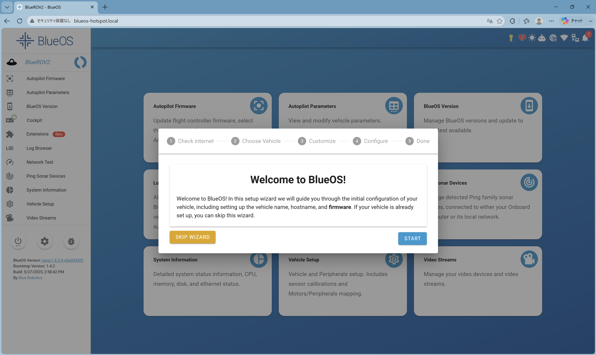

**Step 1: Check Internet（インターネット接続用WiFiへの接続）**  
WiFiネットワーク一覧が表示されます。インターネット接続用WiFiのSSIDを選択し、パスワードを入力して `Connect` をクリックします。  
※ これによりラズパイがインターネットに接続されます。ホットスポットは引き続き動作します。  
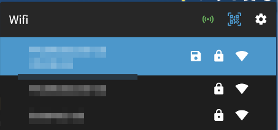

<div style="page-break-before:always"></div>

**Step 2: Choose Vehicle**  
vehicle typeとして `Other` を選択します。  
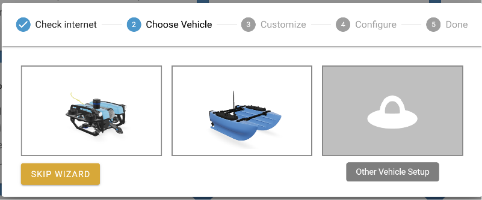

**Step 3: Customize**  
設定はデフォルトのままで構いません。`CONTINUE` をクリックします。  
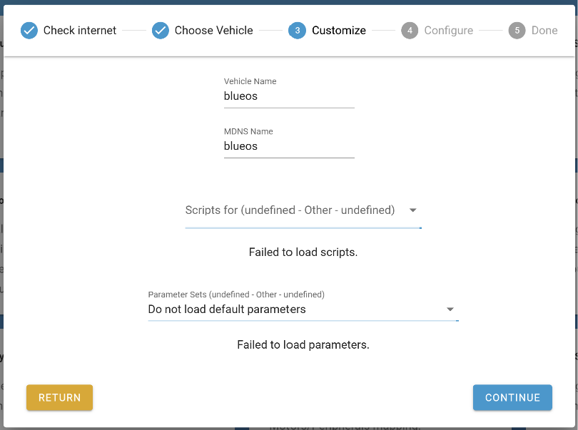

<div style="page-break-before:always"></div>

**Step 4: Configure**  
3項目にチェックが入っていることを確認して `APPLY` をクリックします。  
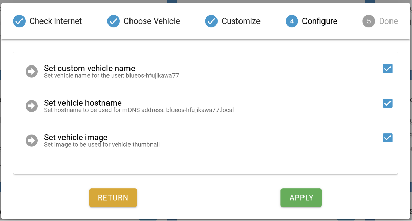

**Step 5: Done**  
ウィザード完了です。

<div style="page-break-before:always"></div>

### 2.3.3. 接続確認
SSHでログインできることを確認します。コマンドプロンプトを起動して下記コマンドを実行します。<br/>
<table>
<tr>
<th>Host</th>
<td>192.168.42.1</td>
</tr>
<tr>
<th>Username</th>
<td>pi</td>
</tr>
<tr>
<th>Password</th>
<td>raspberry</td>
</tr>
</table>
<br/>

```cmd
ssh pi@192.168.42.1 [エンターキー]
```

初めての接続時は質問が表示されるので `yes` と回答します。パスワードは入力しても画面に表示されませんが入力できています。入力ミスをした場合はバックスペースキーで削除できます。  
プロンプトが表示されたらログイン成功です。`exit` でログアウトします。
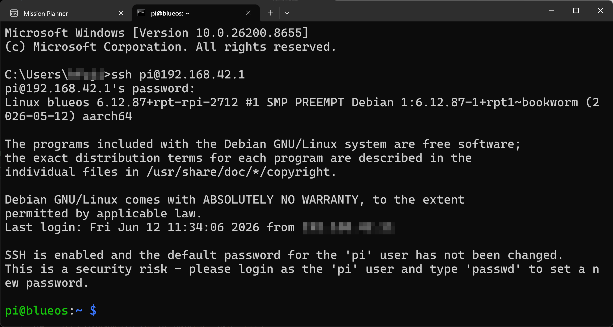

※ SSHログインは通常の手順では使用しませんが、トラブルシューティング等でラズパイ内のファイルを操作する際に使用します。

【発生しうるエラーと対策】  
* `WARNING: REMOTE HOST IDENTIFICATION HAS CHANGED!` が表示されて接続できない  

SDカードを書き直した場合や別のラズパイに替えた場合、同じIPアドレス（`192.168.42.1`）でもホスト鍵が変わるため、PCに保存されている前回の鍵と一致せずに表示されます。自分のラズパイに直接接続していることを確認したうえで、次のコマンドで古い鍵を削除し、再度接続してください。
```cmd
ssh-keygen -R 192.168.42.1
```
```cmd
ssh pi@192.168.42.1
```
`Are you sure you want to continue connecting` と表示されたら `yes` と回答します。

<div style="page-break-before:always"></div>

## 2.4. Pirate Modeの有効化
本書ではベータ版への切り替えや `MAVLink Inspector` などの高度な設定項目・メニューを使用するため、**Pirate Mode** を有効にする必要があります。

PC上でブラウザを起動して、BlueOS管理画面（[http://192.168.42.1](http://192.168.42.1)）を開きます。  
画面右上のアイコンバーにある **☠️ （海賊アイコン）** をクリックします。  
`ENABLE PIRATE MODE` ボタンをクリックします。  
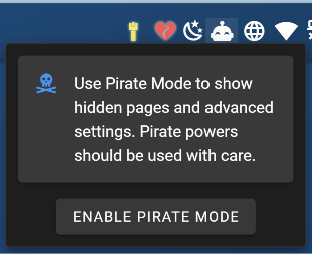

Pirate Modeが有効になると左メニューに `MAVLink Inspector` などの追加メニューが表示されます。

<div style="page-break-before:always"></div>

## 2.5. BlueOSのバージョン切り替え
本書で使用するBlueOS内蔵SITLの起動位置の指定（第3章。`SIM_OPOS_*` パラメータで指定）は、BlueOS 1.5.0-beta.39以降で使用できます。本書ではバージョンを、1.5系の最新ベータ版である **`1.5.0-beta.43`** に固定して使用します。  
※ 執筆時点の安定版（1.4.3）にはこの機能がありません。1.5.0の正式リリース後はそちらに読み替えてください。

1. 左側メニューから `BlueOS Version` をクリックします。
1. リモートバージョン一覧から `1.5.0-beta.43` を探し、ダウンロードして適用します。
1. 適用するとBlueOSが再起動します。再起動後、画面左下のバージョン表示が `1.5.0-beta.43` になっていることを確認します。

※ ダウンロードには時間がかかります。インターネット接続（2.3.2 Step 1）が完了している必要があります。  
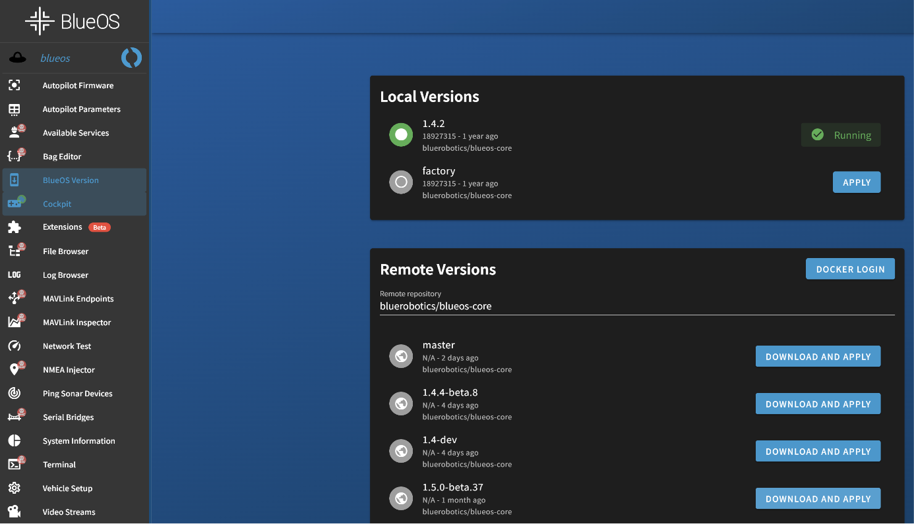

※ 画像に表示されているバージョンは例です。画像と異なる場合でも、必ず本書で指定した **`1.5.0-beta.43`** を選択してください。

<div style="page-break-before:always"></div>

# 3. SITLの起動設定

本書ではラズパイにフライトコントローラー（FC）実機を接続する代わりに、**BlueOS内蔵のSITL**（Software In The Loop：ArduPilotのシミュレータ）を機体として使用します。  
BlueOSのボードを `SITL` に設定してArduPilot（SITL）を起動すると、BlueOSはこれを実機FCと同じように扱い、MAVLink Server経由で各クライアントにテレメトリを配信します。WSL側でSITLを起動したり、BlueOSに接続したりする必要はありません。

## 3.1. SITLボードへの切り替え
1. BlueOS管理画面 → 左メニュー `Autopilot Firmware` をクリックします。
2. 画面下部の `CHANGE BOARD` ボタンをクリックします。
3. Board を `SITL` に変更して `SET` をクリックします。

※ Firmware update欄の `Board` リストボックスはファームウェアの書き込み先を選ぶものです。ボードの切り替えには使用しません。

## 3.2. SITLファームウェアのインストールと起動
`Firmware update` を展開し、下記を入力して `INSTALL FIRMWARE` をクリックします。

| 項目 | 値 |
|------|-----|
| Vehicle Type | Copter |
| Firmware | DEV |

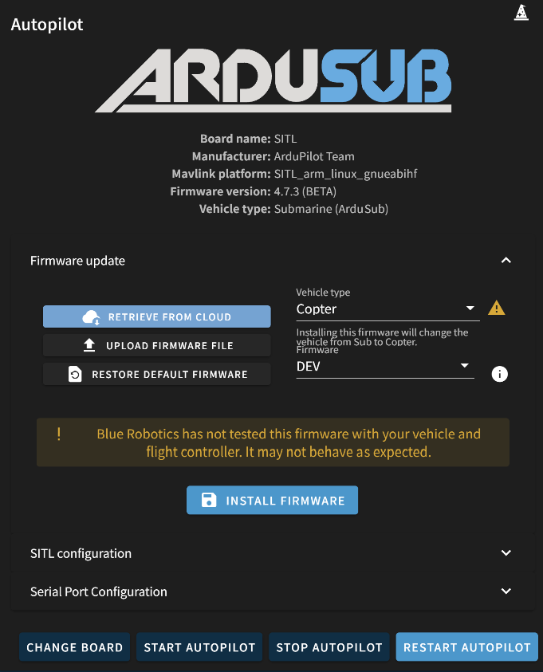

`Successfully installed new firmware` が表示されたら、`START AUTOPILOT` をクリックします。  
これでBlueOS上でSITLが起動し、MAVLink Server経由でMission Planner（UDP 14550）等に接続できます。

## 3.3. Mission Plannerからの接続確認
まず、BlueOS内蔵SITLのテレメトリがMAVLink Serverに届いていることを、BlueOSのWeb管理画面から確認します。

左側メニューから `MAVLink Inspector` をクリックします。  
`HEARTBEAT` や `ATTITUDE` などのMAVLinkメッセージがリアルタイムに受信・表示されていることを確認します。  
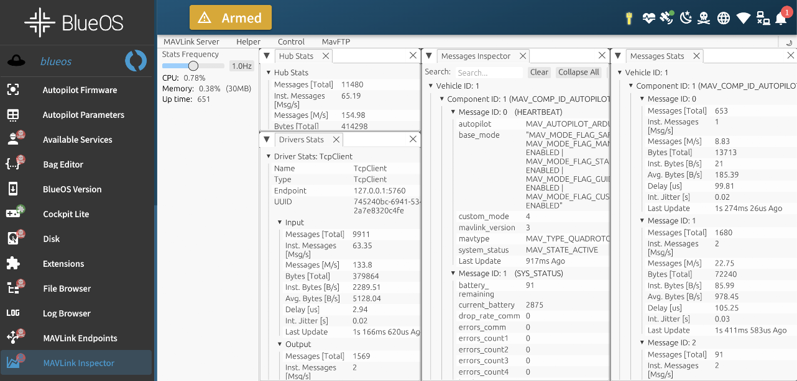

メッセージが表示されない場合は、ここまでの設定（SITLボード、ファームウェアのインストール、`START AUTOPILOT` の実行）を見直してください。

次に、PC側のGCSからテレメトリを受信できることを確認します。  
PCがBlueOSホットスポットに接続している状態で、Mission Plannerを起動します。  
起動時に下記のダイアログ（`A Mavlink stream has been detected, blueos-avahi...`）が表示された場合は、`Yes` をクリックします。これだけで接続が完了します。  
※ BlueOSが通知するMAVLinkストリームへの自動接続の確認です。  
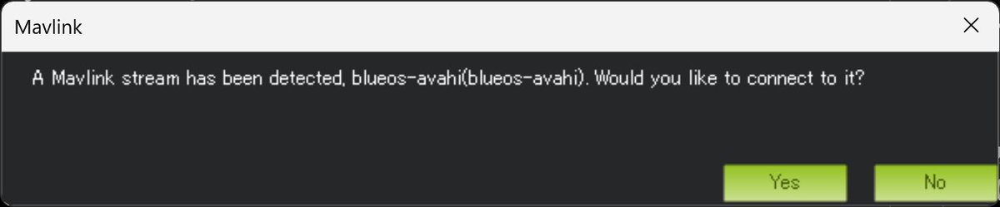

ダイアログが表示されなかった場合は、画面右上の接続リストボックスから `UDPCl` を選択して `接続` をクリックし、下記を入力します。

| 項目 | 値 |
|------|-----|
| remote host | 192.168.42.1 |
| remote Port | 14550 |

接続が完了すると、フライト・データ画面のHUDに姿勢・高度などのテレメトリが表示され、地図上に機体（シミュレータ）が表示されることを確認します。機体はフロリアノポリス（ブラジル）付近に表示されます（起動位置は次の3.4節で変更します）。  
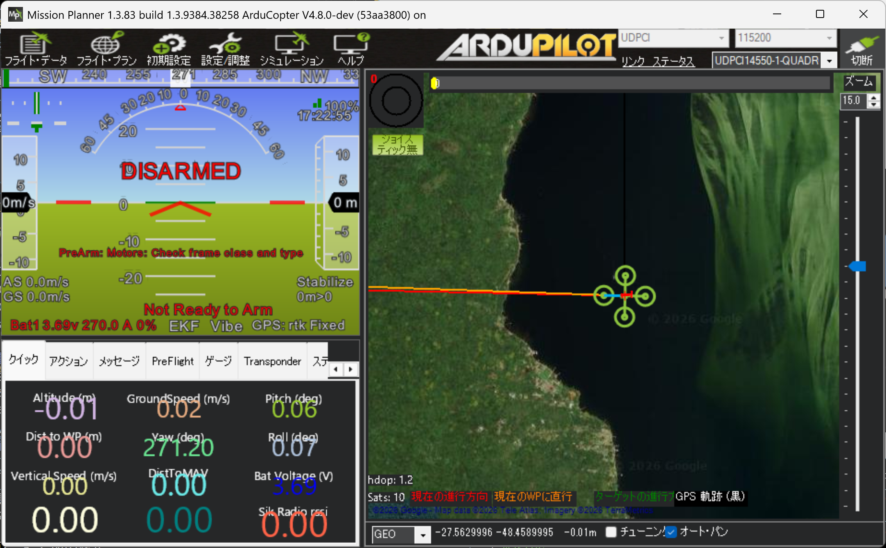


## 3.4. 起動位置の設定（ドローンフィールドKawachi）
BlueOS内蔵SITLの既定の起動位置は、フロリアノポリス（ブラジル）です。本書では、ドローンフィールドKawachiで起動するように設定します。  
起動位置は ArduPilot のパラメータ `SIM_OPOS_LAT` / `SIM_OPOS_LNG` / `SIM_OPOS_ALT` / `SIM_OPOS_HDG` で指定できます（BlueOS 1.5.0-beta.39以降）。

BlueOSのパラメータ編集画面から変更します。ドローンフィールドKawachiの値は下記の通りです。

| パラメータ | 値 | 内容 |
|------|-----|------|
| `SIM_OPOS_LAT` | `35.879129` | 緯度 |
| `SIM_OPOS_LNG` | `140.339683` | 経度 |
| `SIM_OPOS_ALT` | `7` | 高度（m） |
| `SIM_OPOS_HDG` | `0` | 方位（度） |

1. BlueOS管理画面 → 左メニュー `Autopilot Parameters` を開きます。
1. 検索欄に `SIM_OPOS` を入力します。
1. 上表の通りに各パラメータの値を変更します。


設定を反映するため、オートパイロットを再起動します。

1. BlueOS管理画面の左下の電源アイコンをクリックし、`Restart Autopilot` を選択します。
1. 再起動後、Mission Plannerの地図上で機体の位置がドローンフィールドKawachiになっていることを確認します。  
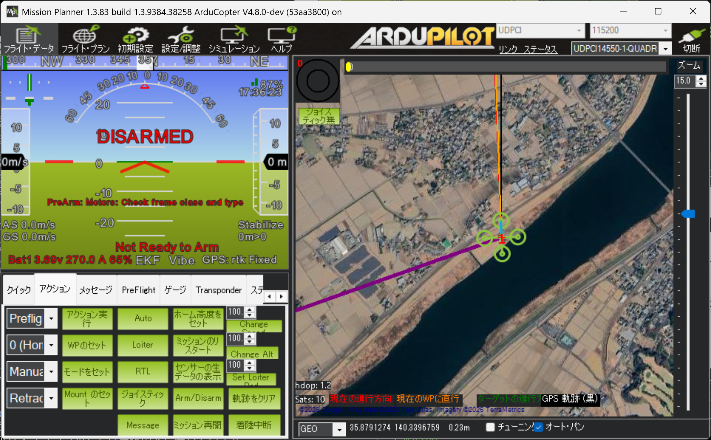


## 3.5. 機体設定
BlueOS内蔵SITLを、Copter（クアッド）として飛行できるように設定します。

### 3.5.1. 機体モデルの設定（sitl_frame）
BlueOS内蔵SITLの機体モデルは、既定で `vectored`（水中ROV向け）になっている場合があります。Copterとして飛行させるため、`quad` に変更します。この設定はBlueOSの管理画面から変更できます。SSHでログインする必要はありません。

1. BlueOS管理画面 → 左メニュー `Autopilot Firmware` を開きます。
1. `SITL configuration` を展開します。
1. `SITL frame` のリストから `quad` を選択します。
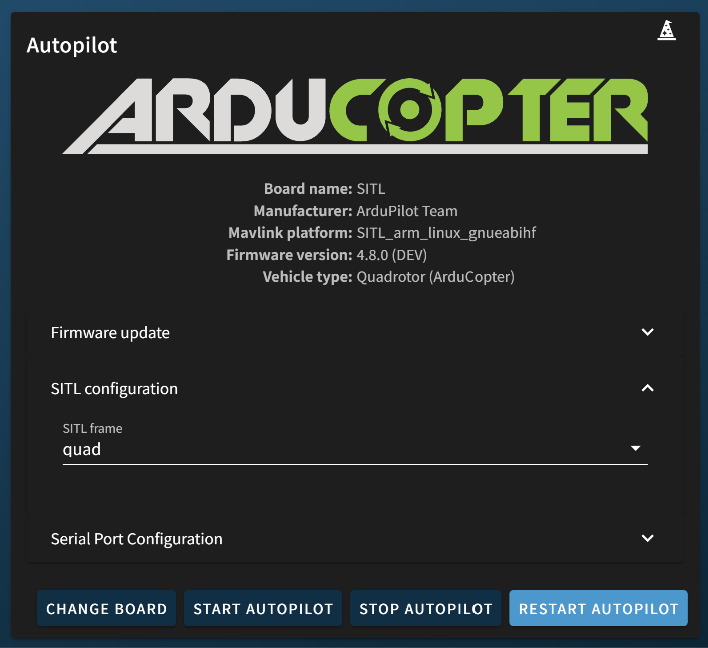

選択すると設定が保存され、オートパイロットが自動で再起動します。再起動が終わると `SITL frame set, autopilot restarted` と表示されます。再起動後、`SITL frame` が `quad` になっていることを確認します。

※ `SITL configuration` は、ボードが `SITL` のときだけ表示されます。表示されない場合は、[3.1節](#31-sitlボードへの切り替え)でボードが `SITL` になっていることを確認してください。

<div style="page-break-before:always"></div>

### 3.5.2. フレーム設定
BlueOS管理画面 → 左メニュー `Autopilot Parameters` を開きます。検索欄に `FRAME_` を入力し、下記の値になっていることを確認します。異なる場合は値を変更します。

| パラメータ | 値 | 内容 |
|------|-----|------|
| `FRAME_CLASS` | `1` | Quad |
| `FRAME_TYPE` | `1` | X |

変更した場合は、[3.4節](#34-起動位置の設定ドローンフィールドkawachi)と同じ手順でオートパイロットを再起動します。

### 3.5.3. 加速度計のキャリブレーション
BlueOS管理画面の左メニューから `Vehicle Setup` → `CONFIGURE` → `ACCELEROMETER` → `QUICK CALIBRATION` をクリックして、キャリブレーションを実施します。  
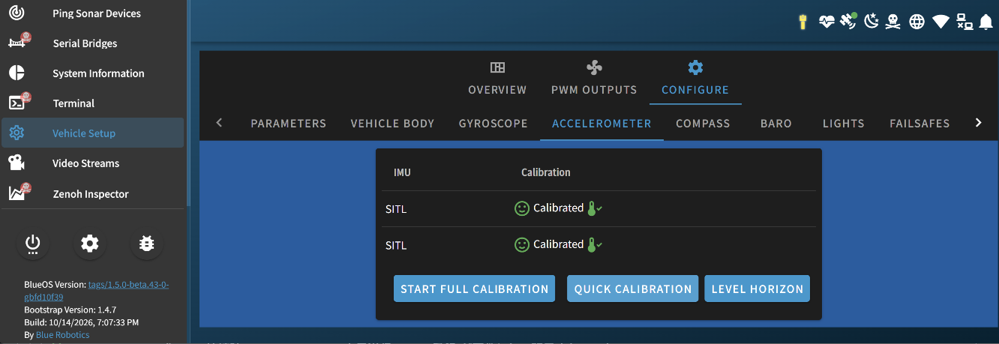


## 3.6. 飛行動作の確認
Mission Plannerから機体（SITL）にコマンドを送信できること（双方向の疎通）を確認します。

フライト・データ画面左下の `アクション` タブを開きます。
1. モードのリストボックスから `Guided` を選択して `モードをセット` をクリックします。
1. `Arm/Disarm` をクリックしてアームします。
1. 地図上で右クリックして `離陸` を選択し、高度 `10` を入力します。

機体が離陸して高度10mでホバリングすることを確認します。  
※ SITL起動直後はGPS測位（EKFの初期化）待ちでアームできないことがあります。その場合は1分ほど待ってから再実行してください。  
※ アームと離陸の操作の詳細は、環境構築手順書（`drone-dev-env-setup-guide.pdf`）の `2.3.1. アームと離陸` もご覧ください。

以上で環境構築は完了です。

<div style="page-break-before:always"></div>

# 4. Appendix
## 4.1. 参考情報
### 4.1.1. BlueOS
1. Official Website：[https://blueos.cloud/](https://blueos.cloud/)
2. Documentation：[https://blueos.cloud/docs/stable/](https://blueos.cloud/docs/stable/)
3. GitHub：[https://github.com/bluerobotics/BlueOS](https://github.com/bluerobotics/BlueOS)
4. Releases（イメージダウンロード）：[https://github.com/bluerobotics/BlueOS/releases](https://github.com/bluerobotics/BlueOS/releases)
### 4.1.2. ArduPilot SITL
1. ArduPilot Wiki：[https://ardupilot.org/dev/docs/sitl-simulator-software-in-the-loop.html](https://ardupilot.org/dev/docs/sitl-simulator-software-in-the-loop.html)
### 4.1.3. Mission Planner
1. ArduPilot Wiki：[https://ardupilot.org/planner/](https://ardupilot.org/planner/)
### 4.1.4. Cockpit
1. GitHub：[https://github.com/bluerobotics/cockpit](https://github.com/bluerobotics/cockpit)
2. ドキュメント：[https://blueos.cloud/docs/stable/extensions/cockpit/](https://blueos.cloud/docs/stable/extensions/cockpit/)


## 4.2. （参考）実機FC（フライトコントローラー）を接続する場合

本書ではFC実機の代わりにBlueOS内蔵のSITLを機体として使用しますが、ラズパイにFC実機を接続して使用することもできます。実機を接続する場合の手順を参考として示します。

<div style="page-break-before:always"></div>

**接続手順**

1. FCをUSBケーブルでラズパイのUSBポートに接続します。  
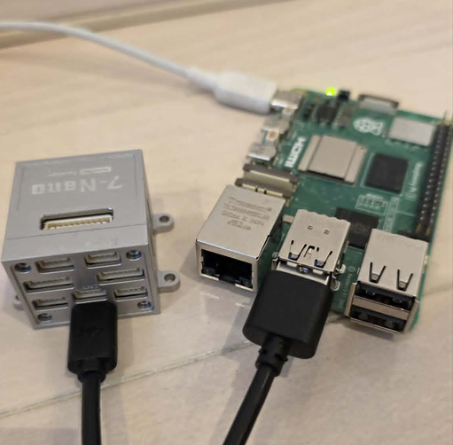

2. BlueOS管理画面 → 左メニュー `Autopilot Firmware` を開きます。
3. 画面下部の `CHANGE BOARD` ボタンをクリックします。`Available boards` に接続したFC（例: `CUAV-7-Nano`）が表示されるので選択して適用します。  
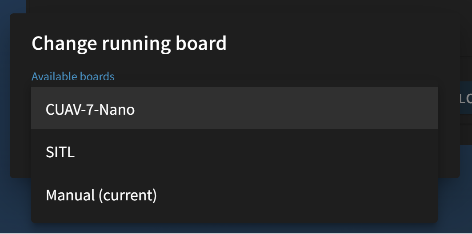

4. 適用後、Autopilotパネルに接続したボードの情報が表示されることを確認します。`Board name` に接続したFC名、`Path` に `/dev/ttyACM0` などのシリアルデバイスが表示されていれば、FCが正常に認識されています。  
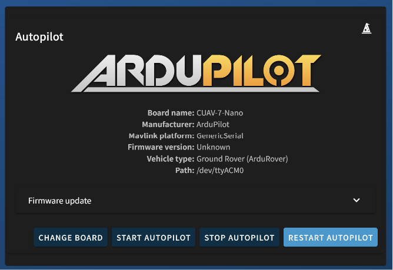

FCが認識されると、SITLの場合と同様にMAVLink Server経由でMission Planner（UDP 14550）等のクライアントから接続できます。エンドポイントの追加設定は不要です（[3.3節](#33-mission-plannerからの接続確認)参照）。

※ 実機FCを接続する場合は、第3章の `SITL` ボードへの切り替えやSITLの起動は不要です。

## 4.3. （参考）CockpitからのGCS接続確認（任意）
BlueOSに内蔵されたWebブラウザ版GCS「Cockpit」からテレメトリを確認します。  
Mission Plannerを使わずにブラウザだけで機体の状態を確認・操作できることを体験する目的で実施します。

PCのブラウザで `http://192.168.42.1` を開き、左メニューから `Cockpit` をクリックします。  
※ 左メニューに `Cockpit` が表示されない場合は、左メニュー下部の `Tools` → `Extensions Manager` からインストールしてください。

Cockpitの画面に切り替わり、機体（SITL）のテレメトリ（高度、機首方位、フライトモード等）が表示されることを確認します。
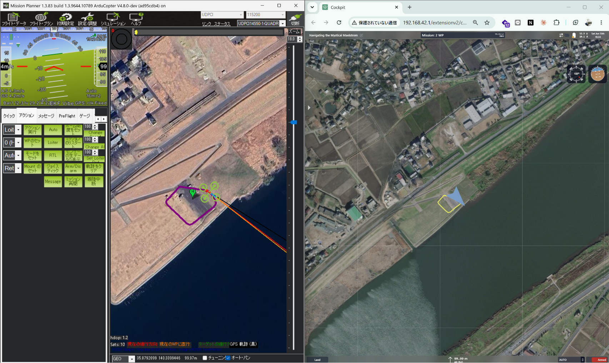
