<div align="center">
<h3>Drone Engineer Training Program - Developer Course</h3>
<h2>Development Environment Setup Guide</h2><br>
(Windows11 + WSL2(Ubuntu22.04) + Visual Studio Code)<br/>
Ver.1.4.9 - 2026.11.14
</div>

<!--
Ver.1.4.0 - 2023.5.26 - Initial release
Ver.1.4.1 - 2023.6.9  - Changed the WSL installation method, adjusted the PDF layout, minor fixes
Ver.1.4.2 - 2023.7.11 - Revised the PDF generation method, adjusted line breaks in images and code
Ver.1.4.3 - 2024.11.9 - Revised the steps for WSL2 and Ubuntu22.04
Ver.1.4.4 - 2025.5.17 - Updated the Appendix
Ver.1.4.5 - 2025.11.8 - Changed some GitHub repositories to be forked and cloned
Ver.1.4.6 - 2026.6.8  - Fixed typos
Ver.1.4.7 - 2026.6.15 - Changed 20th -> 21st
Ver.1.4.8 - 2026.11.12 - Removed DroneKit Python, made the term number examples generic
Ver.1.4.9 - 2026.11.14 - Changed the prerequisite to Windows 11, replaced the overview diagram, updated the WSL steps, revised sections 9.3/9.4
-->

Table of Contents
<!-- @import "[TOC]" {cmd="toc" depthFrom=1 depthTo=6 orderedList=false} -->

<!-- code_chunk_output -->

- [1. Introduction](#1-introduction)
- [2. Mission Planner Setup](#2-mission-planner-setup)
  - [2.1. Installing Mission Planner](#21-installing-mission-planner)
  - [2.2. Starting the Simulator (Mission Planner)](#22-starting-the-simulator-mission-planner)
  - [2.3. Basic Vehicle Operations Using Mission Planner](#23-basic-vehicle-operations-using-mission-planner)
    - [2.3.1. Arming and Taking Off](#231-arming-and-taking-off)
    - [2.3.2. Creating a Mission and Flying Automatically](#232-creating-a-mission-and-flying-automatically)
- [3. Installing Visual Studio Code](#3-installing-visual-studio-code)
- [4. Installing Ubuntu on WSL](#4-installing-ubuntu-on-wsl)
  - [4.1. Enabling WSL](#41-enabling-wsl)
  - [4.2. Installing and Initial Setup of Ubuntu 22](#42-installing-and-initial-setup-of-ubuntu-22)
- [5. Integrating Visual Studio Code with WSL](#5-integrating-visual-studio-code-with-wsl)
  - [5.1. Installing Extensions](#51-installing-extensions)
  - [5.2. Enabling the Japanese Display Language](#52-enabling-the-japanese-display-language)
  - [5.3. Connecting to WSL](#53-connecting-to-wsl)
- [6. ArduPilot Build Environment Setup](#6-ardupilot-build-environment-setup)
  - [6.1. Forking and Cloning the ArduPilot Source Code](#61-forking-and-cloning-the-ardupilot-source-code)
  - [6.2. Installing the Environment with the Setup Script](#62-installing-the-environment-with-the-setup-script)
- [7. Installing Extensions in WSL (Ubuntu22.04)](#7-installing-extensions-in-wsl-ubuntu2204)
- [8. Simulator (SITL) Setup](#8-simulator-sitl-setup)
  - [8.1. Verifying the Simulator](#81-verifying-the-simulator)
- [9. [Application Course] Setting Up Pymavlink](#9-application-course-setting-up-pymavlink)
  - [9.1. Getting the Source Code from GitHub and Installing](#91-getting-the-source-code-from-github-and-installing)
  - [9.2. Visual Studio Code Code Completion Settings](#92-visual-studio-code-code-completion-settings)
  - [9.3. Verifying the Connection](#93-verifying-the-connection)
    - [9.3.1. Verifying with Pymavlink](#931-verifying-with-pymavlink)
  - [9.4. Preparing a GitHub Repository for Assignment Submission](#94-preparing-a-github-repository-for-assignment-submission)
- [10. [Flight Code Course] Setting Up the Debugging Environment](#10-flight-code-course-setting-up-the-debugging-environment)
  - [10.1. Installing Required Packages](#101-installing-required-packages)
  - [10.2. Adding a Debug Configuration](#102-adding-a-debug-configuration)
  - [10.3. Setting Breakpoints](#103-setting-breakpoints)
  - [10.4. Running the Debugger](#104-running-the-debugger)
- [11. Appendix](#11-appendix)
  - [11.1. Mission Planner](#111-mission-planner)
  - [11.2. Visual Studio Code](#112-visual-studio-code)
  - [11.3. MAVProxy](#113-mavproxy)
  - [11.4. Pymavlink](#114-pymavlink)

<!-- /code_chunk_output -->

<div style="page-break-before:always"></div>

## Change History

| Date | Version | Changes and reasons |
|------|-----------|--------------|
| 2026.6.15 | 1.4.7 | Section 9.3: Added an explanation of the destination IP address for each SITL launch method (MP/WSL)<br>Section 9.4: Changed 20th → 21st |
| 2026.11.12 | 1.4.8 | Chapter 9: Removed DroneKit Python<br>Section 9.4: Changed the term number examples to the generic `1st`, `2nd` … |
| 2026.11.14 | 1.4.9 | Chapters 1 and 4: Changed the prerequisite to Windows 11, replaced the overview diagram in chapter 1, removed the version check, updated the WSL steps<br>Sections 9.3 and 9.4: Fixed wording and indentation, added a note about term numbers |

<div style="page-break-before:always"></div>

# 1. Introduction
This guide describes how to set up an environment for developing and testing ArduPilot drone software using Windows11 + WSL2 (Ubuntu22.04) + Visual Studio Code.  
The scope of this guide within the development environment is shown in the figure below.  
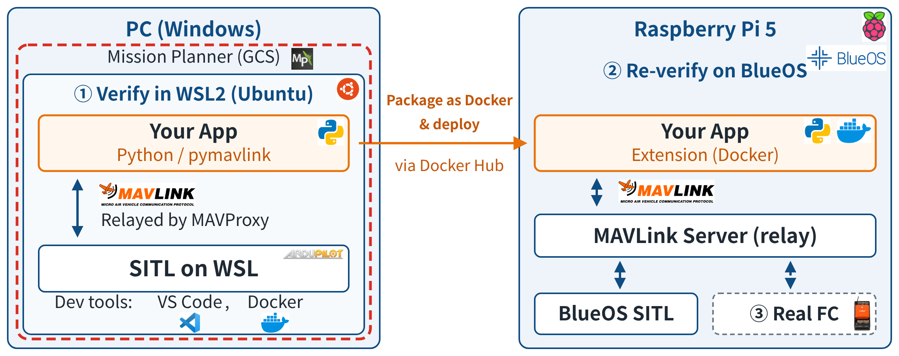  

<div style="page-break-before:always"></div>  

# 2. Mission Planner Setup
## 2.1. Installing Mission Planner
[Note] Skip this section if it is already installed.  

Click the link below to download the latest installer.  
https://firmware.ardupilot.org/Tools/MissionPlanner/MissionPlanner-latest.msi  

Double-click the downloaded installer `MissionPlanner-latest.msi`.  

Accept the license agreement, and basically click `Next`, `Install`, and `Finish` to complete the installation.  

Type `Mission Planner` in the taskbar search box and start Mission Planner.  

If the Altitude Angel dialog appears, click `No`. (First launch only)  

## 2.2. Starting the Simulator (Mission Planner)
Click `SIMULATION` in the top menu to switch to the simulation screen.  
  

To specify the home position, enter `--home 35.879129,140.339683,7,0` (the location of Drone Field Kawachi) in Extra command line, and click the `Multirotor` icon at the bottom of the screen.   
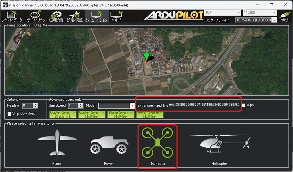  

When the Select your version dialog appears, click `Stable`.  
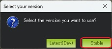  

The simulator executable starts downloading and launches when the download is complete.
After startup, the display switches to the flight data screen and connects to the vehicle (simulator).  
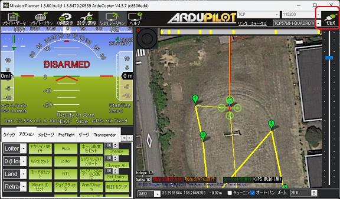  

To exit the simulator, close the terminal window whose title bar shows `ArduCopter.exe`.  
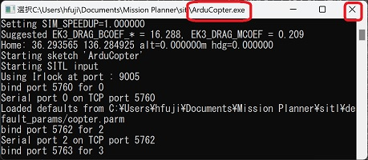  

<div style="page-break-before:always"></div>  

From the second time onward, you can check `Skip Download` to skip downloading the executable and start the simulator.  
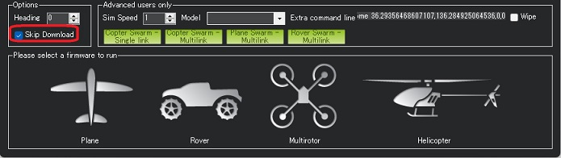  

<div style="page-break-before:always"></div>  

## 2.3. Basic Vehicle Operations Using Mission Planner
[Note] Perform these steps while connected to the vehicle (simulator).  
### 2.3.1. Arming and Taking Off
Click `DATA` in the top menu to switch to the flight data screen.  
  

Open the Actions tab, select `Guided` from the list box, and click the `Set Mode` button to switch the vehicle to GUIDED mode. Then click the `Arm/Disarm` button to arm the vehicle.  
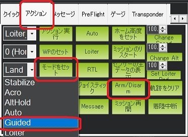  
Confirm that `ARMED` and `Guided` are displayed on the HUD as shown below.  
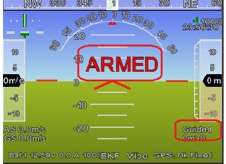  

Right-click on the map area → click `Takeoff` → enter `10` in the Enter Alt dialog and click `OK`.  
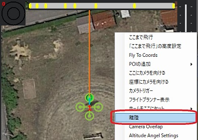
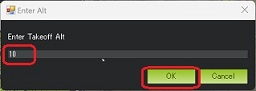

Confirm that the vehicle takes off, climbs to an altitude of 10 meters, and hovers.  
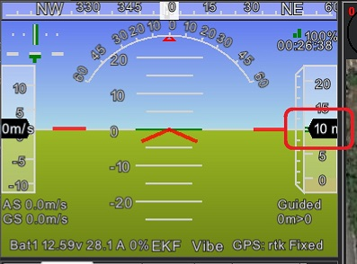  

<div style="page-break-before:always"></div>  

To fly automatically to a specified destination, right-click anywhere on the map area → click `Fly To Here` → enter `10` in the Enter Alt dialog and click `OK`.  
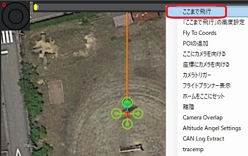
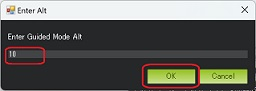  

The vehicle starts flying automatically to the specified point. When it reaches the destination, it hovers.  
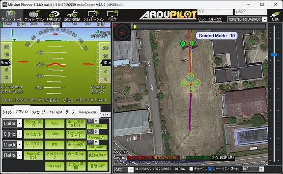  

To land on the spot, select `Land` from the list box and click the `Set Mode` button. To return to the home position and land, click the `RTL` button.  

<div style="page-break-before:always"></div>  

### 2.3.2. Creating a Mission and Flying Automatically
[Note] Perform these steps while the vehicle (simulator) is hovering.  

Click `PLAN` in the top menu to switch to the flight plan screen.  
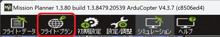  

Enter `10` for the default altitude. Left-click the map area to add waypoints and create a mission. Click the `Write WPs` button to upload the created mission to the vehicle.  
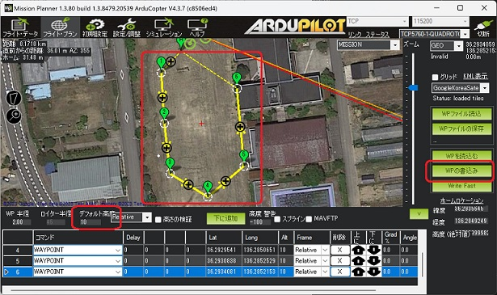  

Click `DATA` in the top menu to switch to the flight data screen.  
  

<div style="page-break-before:always"></div>  

Open the Actions tab and click the `Auto` button to switch to AUTO mode.  
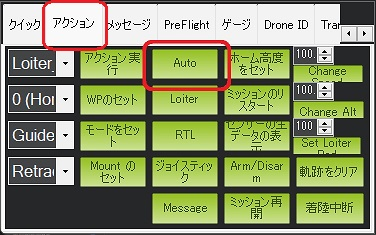  

The vehicle starts flying automatically based on the created mission. When the mission is complete, it hovers.  
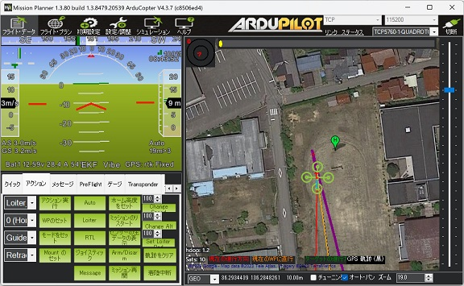  

To run the mission again, switch to another mode such as LOITER or GUIDED, and then switch back to AUTO mode.  

<div style="page-break-before:always"></div>  

# 3. Installing Visual Studio Code
[Note] Skip this chapter if it is already installed.  

Open the site below.  
https://code.visualstudio.com/  
Click `Download for Windows` to start the download.  
Double-click the downloaded exe file `VSCodeUserSetup-x64-＜version＞.exe` and proceed with the installation.

<div style="page-break-before:always"></div>  

Basically, click `Next` and `Install` to proceed with the installation. On the screen below, select `Add to PATH`.  

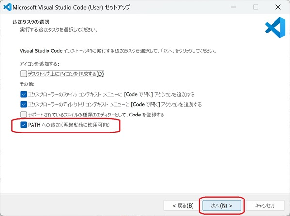  

When the Visual Studio Code installation is complete, restart your PC and proceed to the next step.

<div style="page-break-before:always"></div>

# 4. Installing Ubuntu on WSL
## 4.1. Enabling WSL
On company PCs with security measures in place, or if virtualization features are disabled, the setup may fail. Please contact your company's technical support department.

To enable WSL, open PowerShell as an administrator.  
Type `PowerShell` in the taskbar search box and search for it.  
  

<div style="page-break-before:always"></div>

Click the `>` button on the right of `Windows PowerShell` in the search results, and click `Run as administrator`.  

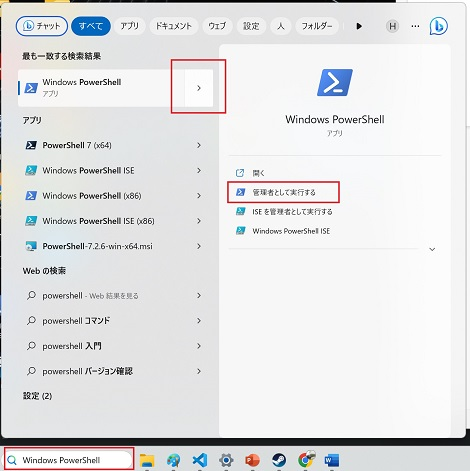  

In the PowerShell window that opens, run the following command and restart your PC. This enables the Windows features required for WSL. Do not install a distribution here, because Ubuntu is installed in the next section.
```powershell
wsl --install --no-distribution
```

> **Note**
> If the command above is unavailable or fails, run the following two commands in order to enable the Windows features manually, and then restart your PC.
> ```powershell
> dism.exe /online /enable-feature /featurename:Microsoft-Windows-Subsystem-Linux /all /norestart
> ```
> ```powershell
> dism.exe /online /enable-feature /featurename:VirtualMachinePlatform /all /norestart
> ```

After restarting your PC, open PowerShell, run the following commands, and then close PowerShell. This updates WSL to the latest version and sets the default WSL version to 2.  
If you want to change the default back from version 2 to 1, run `wsl --set-default-version 1`.  
```powershell
wsl --update
```
```powershell
wsl --set-default-version 2
```

<div style="page-break-before:always"></div>

## 4.2. Installing and Initial Setup of Ubuntu 22
[Note] Skip this section if Ubuntu22.04 is already installed.

Open PowerShell and run the following command to install `Ubuntu-22.04`.
```powershell
wsl --install -d Ubuntu-22.04
```

[Possible errors and solutions]  
* Kernel-related errors  
If the following error is displayed and the installation fails

```powershell
Installing, this may take a few minutes...
WslRegisterDistribution failed with error: 0x800701bc
Error: 0x800701bc WSL 2 ???????????? ??????????????????????? https://aka.ms/wsl2kernel ?????????

Press any key to continue...
```

First, run `wsl --update` in PowerShell to update WSL. If that does not resolve the problem, refer to the URL below, download and install the Linux kernel update package, and then perform [4.2. Installing and Initial Setup of Ubuntu 22](#42-installing-and-initial-setup-of-ubuntu-22) again.  
https://learn.microsoft.com/en-us/windows/wsl/install-manual#step-4---download-the-linux-kernel-update-package

* The screen does not progress  
If the display below does not change for more than 15 minutes, press Ctrl+c to move on.

```
Installing, this may take a few minutes...
```

When the installation completes successfully, restart your PC.  
The first time you start after restarting, `Installing, this may take a few minutes…` is displayed for a while. This is not a freeze, so just wait until the installation completes.  

<div style="page-break-before:always"></div>

When the installation finishes, you will be asked for a username and password. Enter them as shown below. Use only half-width alphabetic characters.

* username : `ardupilot`
* password : `ardupilot` 

For security reasons the password is not displayed as you type, but it is being entered. If you make a mistake, you can erase it with the backspace key.
If you see the screen shown in the image, the Ubuntu installation is complete. Close this window.  
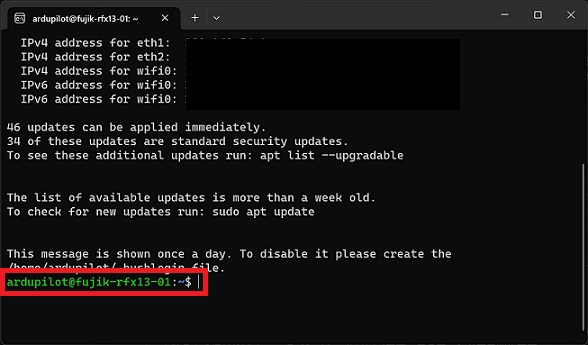  

As a precaution, check the WSL version. Start PowerShell and run the following command.
```powershell
wsl -l -v
```
There is no problem if `2` is displayed under VERSION.
```powershell
  NAME                   STATE           VERSION
* Ubuntu-22.04           Running         2
```

> **Note**
> WSL versions 1 and 2 can coexist. If you want to use USB devices such as a real vehicle device with WSL2, you need to install `usbipd-win` and attach the device separately. If this setup is difficult, consider using WSL1. If you only use the simulator, WSL2 is recommended because it processes faster.

When the Ubuntu installation is complete, proceed to the next step to integrate it with Visual Studio Code.  

<div style="page-break-before:always"></div>

# 5. Integrating Visual Studio Code with WSL
[Note] Skip this chapter if the integration is already done.  

Start Visual Studio Code. If a warning window like the following appears on first launch, select `Allow access`.  
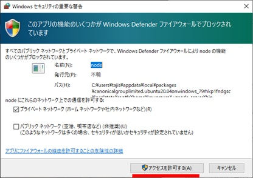

When Visual Studio Code has started, proceed to the next steps.
## 5.1. Installing Extensions
Select `Extensions (the block-like icon)` on the left and install the extensions. Type `remote dev` in the search box, search, and select `Remote Development`. Select `Install` on the details screen.  
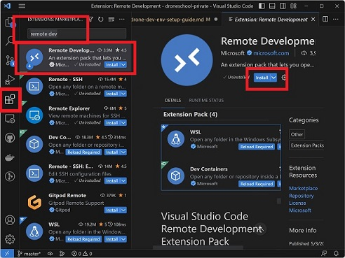

<div style="page-break-before:always"></div>

Install the following extensions in the same way.

|Extensions|Search keyword|Description|
|----|----|----|
|Japanese Language Pack for Visual Studio Code|japanese|Japanese display language|
|Python|Python|Python language support|
|Black Formatter|Black Formatter|Python code formatter|
|C/C++|C++|C/C++ language support|
|Lua|Lua|Lua language support|
|ardupilot-devenv|ardupilot|ArduPilot development support|
|Lua Autocomplete for ArduPilot|ardupilot|Lua language support for ArduPilot|

## 5.2. Enabling the Japanese Display Language
Press `Ctrl + Shift + P` and type `Configure Di` in the input area that appears.  
From the suggestions, select `Configure Display Language`.  
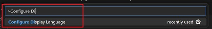

From the suggestions that appear next, select `Japanese (ja)`.   
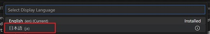


You will be prompted to restart Visual Studio Code, so restart it. When it has started, proceed to the next steps. 
## 5.3. Connecting to WSL
As shown in the image, select `Remote Explorer (the icon that looks like a PC screen)` on the left.  
When the screen changes, switch `Remote Explorer` to `WSL Targets`. Confirm that the installed `Ubuntu22.04` is displayed as in the image. If you are familiar with WSL, your setup does not need to match this exactly, so proceed to the build environment setup.  
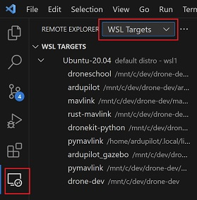  

Right-click `Ubuntu22.04` and select `Set as Default Distribution` to make it the default.  
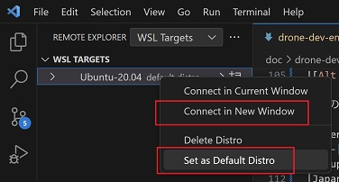

After that, connect to WSL using `Connect in New Window` from the same right-click menu.
A new window opens. Confirm that the bottom-left corner shows a connected state like the one in the image.  
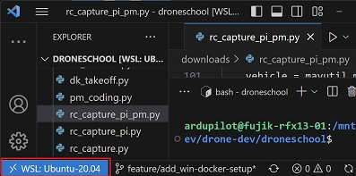

<div style="page-break-before:always"></div>

# 6. ArduPilot Build Environment Setup
[Note] Skip this chapter if the build environment is already set up.  
## 6.1. Forking and Cloning the ArduPilot Source Code
Open [GitHub](https://github.com/login) and log in. If you do not have a GitHub account, create one by following [these instructions](https://docs.github.com/en/get-started/start-your-journey/creating-an-account-on-github).

Open [https://github.com/ArduPilot/ardupilot.git](https://github.com/ArduPilot/ardupilot.git) and click the `Fork` button at the top right to fork the ArduPilot source code to your own account.  


Start Ubuntu22.04.

Enter the following commands to create the directory into which the ArduPilot source code will be cloned.  
```bash
cd /home/ardupilot
mkdir GitHub
cd GitHub
```
Enter the following command to clone the ArduPilot source code.
```bash
git clone https://github.com/＜your-GitHub-account-name＞/ardupilot.git
```
  
When the clone is complete, run the following environment setup script.  

<div style="page-break-before:always"></div>

## 6.2. Installing the Environment with the Setup Script
Run the following commands in order in the Ubuntu terminal to install and set up the build environment.  
```bash
cd /home/ardupilot/GitHub/ardupilot
```
```bash
./Tools/environment_install/install-prereqs-ubuntu.sh -y
```
You will be asked for your password several times, so enter it each time. The process takes a while, so wait.  
The setup is complete when the following message is displayed.  

```bash
---------- ./Tools/environment_install/install-prereqs-ubuntu.sh end ----------
```

<div style="page-break-before:always"></div>

# 7. Installing Extensions in WSL (Ubuntu22.04)
Start Visual Studio Code and connect to WSL (Ubuntu22.04).  
Select `File` -> `Open Folder` from the menu, and open the ardupilot directory you downloaded in the previous section (path: `/home/ardupilot/GitHub/ardupilot`).  
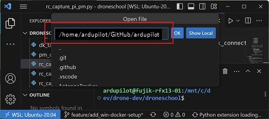  

A trust dialog appears on first launch, so select `Yes, I trust the authors`.  
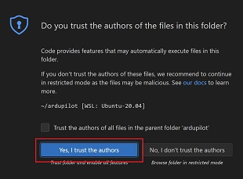

Referring to the steps in [Integrating Visual Studio Code with WSL](#5-integrating-visual-studio-code-with-wsl), install the following extensions.

|Extensions|Search keyword|Description|
|----|----|----|
|Python|Python|Python language support|
|Black Formatter|Black Formatter|Python code formatter|
|C/C++|C++|C/C++ language support|
|Lua|Lua|Lua language support|
|Docker|Docker|Docker support|
|ardupilot-devenv|ardupilot|ArduPilot development support|
|Lua Autocomplete for ArduPilot|ardupilot|Lua language support for ArduPilot|

<div style="page-break-before:always"></div>

# 8. Simulator (SITL) Setup
## 8.1. Verifying the Simulator
Close the Ubuntu terminal and restart your PC.
Start Ubuntu22.04 and run the following command.
```bash
sim_vehicle.py -v Copter --map --console -L Kawachi
```

If a security warning appears, select "Allow access".  
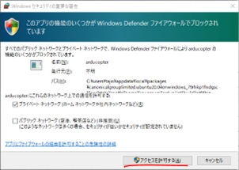

If the display looks like the image, it is working correctly.  
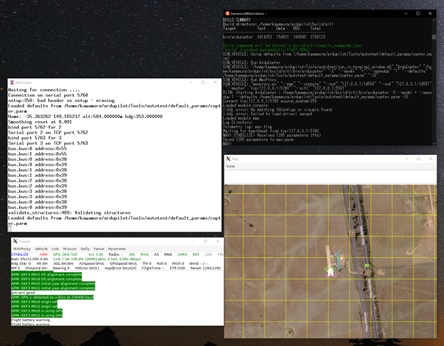  

When you start Mission Planner while the simulator is running, it connects to the simulator automatically over UDP.  
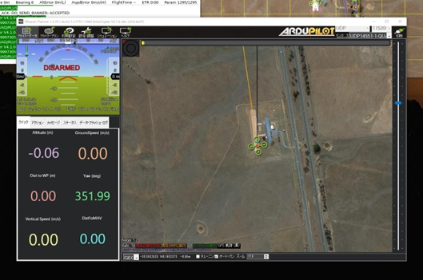  

From the next page onward, set up only the parts you need for your course.  

* [[Application Course] Setting Up Pymavlink](#9-application-course-setting-up-pymavlink)  
* [[Flight Code Course] Setting Up the Debugging Environment](#10-flight-code-course-setting-up-the-debugging-environment)

<div style="page-break-before:always"></div>

# 9. [Application Course] Setting Up Pymavlink
[Note] Skip this chapter if the setup is already done.
## 9.1. Getting the Source Code from GitHub and Installing
Open [https://github.com/hfujikawa77/droneschool.git](https://github.com/hfujikawa77/droneschool.git) and click the `Fork` button at the top right to fork the course material source code to your own account.  


Close the simulator, Ubuntu22.04, and Visual Studio Code. Then start Visual Studio Code and connect to WSL (Ubuntu22.04).

Click `Terminal` → `New Terminal` from the menu to start a terminal.  
Run the following commands to get the development tools and the course material source code from GitHub.
```bash
cd /home/ardupilot/GitHub
git clone https://github.com/＜your-GitHub-account-name＞/droneschool
git clone https://github.com/mavlink-router/mavlink-router
git clone https://github.com/ArduPilot/pymavlink
cd pymavlink
git clone https://github.com/ArduPilot/mavlink
```
Run the following commands to install each development tool. If you are asked for a password, enter it each time.
```bash
# Pymavlink
cd  /home/ardupilot/GitHub/pymavlink
pip install --user .
# MAVLink Router
cd  /home/ardupilot/GitHub/mavlink-router
git submodule update --init --recursive
sudo apt update
sudo apt install -y git meson ninja-build pkg-config gcc g++ systemd
meson setup build . 
ninja -C build 
sudo ninja -C build install
```

<div style="page-break-before:always"></div>

## 9.2. Visual Studio Code Code Completion Settings
Open Visual Studio Code, and select `File` → `Preferences` → `Settings` from the menu. Click the settings file icon at the top right of the screen below.  
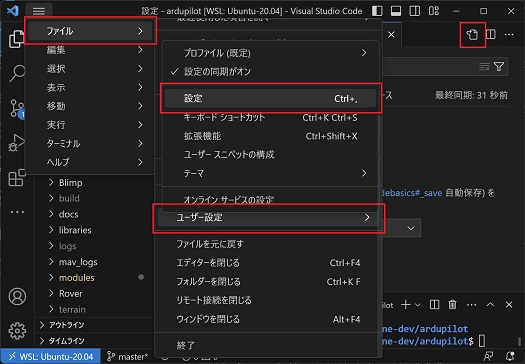  

Add the following settings. If you already have existing settings, adjust them to suit your own environment.  
```json
{
    "python.autoComplete.extraPaths": [
        "/home/ardupilot/GitHub/pymavlink"
    ],
    "python.analysis.extraPaths": [
        "/home/ardupilot/GitHub/pymavlink"
    ],
    ... (omitted) ...
}
```

<div style="page-break-before:always"></div>

To check that code completion works, select `File` → `New File`.  
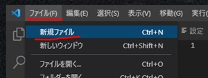  

Next, focus on the new file window and press `Ctrl + s` to display the save menu. Save it as `/home/ardupilot/test.py`.   
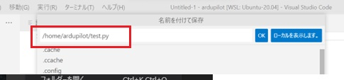  

The setup is complete if completion suggestions appear when you type source code as shown in the image.  
* pymavlink  
  

<div style="page-break-before:always"></div>

## 9.3. Verifying the Connection

Start Visual Studio Code and connect to WSL (Ubuntu22.04).  
Select `File` -> `Open Folder` from the menu and open the `/home/ardupilot/GitHub` directory.  
Start the simulator by following the steps in [2.2. Starting the Simulator (Mission Planner)](#22-starting-the-simulator-mission-planner) or [8.1. Verifying the Simulator](#81-verifying-the-simulator).  

This guide covers the following two ways of launching the simulator. The destination IP address for Pymavlink scripts differs depending on the launch method.

| Type | Launch method | Environment | Destination IP address |
|------|----------|----------|-----------------|
| **MP SITL** | [Section 2.2](#22-starting-the-simulator-mission-planner) (launched from Mission Planner) | On Windows | `＜PC-IP-address＞` (described below) |
| **WSL SITL** | [Section 8.1](#81-verifying-the-simulator) (launched with `sim_vehicle.py`) | On WSL (Ubuntu) | `127.0.0.1` |

**If you use MP SITL:** Run the `ipconfig` command in PowerShell and note your PC's IPv4 address.  
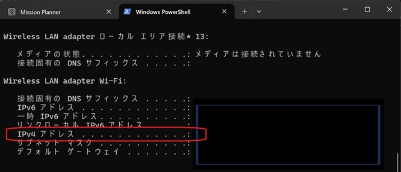  

<div style="page-break-before:always"></div>

### 9.3.1. Verifying with Pymavlink
In the Visual Studio Code explorer, open `GitHub/droneschool/pymavlink_scripts/pm01_message_dump.py`.  
Change the destination on lines 4–5 of the source code to match the simulator you are using.

| Type | Destination setting |
|------|--------------|
| MP SITL | `tcp:＜PC-IP-address＞:5762` |
| WSL SITL | `tcp:127.0.0.1:5762` |

Click the `▷ icon` at the top right. A terminal starts and the Python script runs.  
Confirm that the MAVLink messages received from the vehicle (simulator) are displayed at regular intervals.  
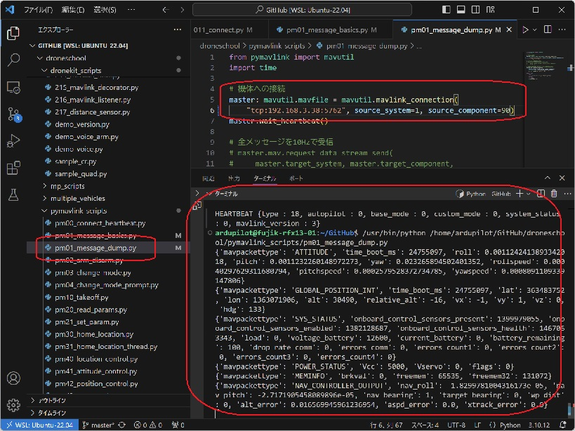  

Press `Ctrl+C` to exit.

<div style="page-break-before:always"></div>

## 9.4. Preparing a GitHub Repository for Assignment Submission

Prepare a GitHub repository for submitting your assignment for the Application track.

**[Important] Term numbers such as `1st` below are only examples. Do not use them as they are; be sure to replace them with the number of the term you are attending.**

1. Move to the local Git repository you have already cloned.
     ```bash
     cd 
     cd GitHub/droneschool
     ```

1. Create a working branch and check it out. In the branch name, replace `＜term_no＞` with the term number (e.g. `1st`, `2nd`, `3rd` …) and `＜fname-lname＞` with your own name. (Example: for the 1st term, `1st_hideyuki-fujikawa` )
     ```bash
     git checkout -b ＜term_no＞_＜fname-lname＞
     ```

1. Create a working directory. In the directory name, replace `＜term_no＞` with the term number (e.g. `1st`, `2nd`, `3rd` …) and `＜fname-lname＞` with your own name. (Example: for the 1st term, `workshop/1st/hideyuki-fujikawa` )
     ```bash
     mkdir -p workshop/＜term_no＞/＜fname-lname＞
     ```
1. Create a README.md file and add some text.
     ```bash
     echo "Hello, ArduPilot!" > workshop/＜term_no＞/＜fname-lname＞/README.md
     ```

1. Push your changes to the remote repository.
     ```bash
     # Stage the changes
     git add workshop/＜term_no＞/＜fname-lname＞/README.md

     # Commit with a commit message
     git commit -m "Add ＜term_no＞ workshop folder with README.md"

     # Push the changes to the remote repository
     git push origin ＜term_no＞_＜fname-lname＞
     ```

<div style="page-break-before:always"></div>

1. Create a Pull Request
    - Go to the `https://github.com/＜your-GitHub-account-name＞/droneschool/pulls` page on GitHub.
    - Click the `New pull request` button.
    - Select the base repository and branch to compare against, and your own forked repository and branch.
      - **base repository**: `hfujikawa77/droneschool`
      - **base**: `master`
      - **head repository**: `＜your-GitHub-account-name＞/droneschool`
      - **compare**: `＜term_no＞_＜fname-lname＞` (Example: for the 1st term, `1st_hideyuki-fujikawa`)
    - Enter a title and description for the Pull Request, and click the `Create pull request` button to create the Pull Request.
  
1. Pull in changes from the original repository  
   Note: Do this if you want to pull in changes from the original (upstream) repository.
    - Return to the main page of your forked repository and select the `master` branch.
    - Click the `Sync fork` button.
    - Click the `Update Branch` button. Confirm that the latest changes from the main line have been pulled in.  
    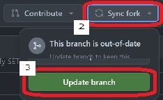


<div style="page-break-before:always"></div>


# 10. [Flight Code Course] Setting Up the Debugging Environment
[Note] Skip this chapter if the setup is already done.
## 10.1. Installing Required Packages
Start Ubuntu22.04 and run the following command.  
```bash
sudo apt install gdb -y
```
## 10.2. Adding a Debug Configuration
Open the ArduPilot source code. Select `File` → `Open Folder…` → enter `/home/ardupilot/GitHub/ardupilot`.  
With any cpp file open, select `Run` → `Add Configuration…` from the menu.  
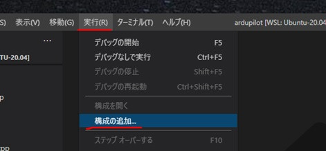  

<div style="page-break-before:always"></div>

Click the `Add Configuration` button at the bottom right of the displayed `launch.json`.
Modify the added configuration as follows and save it. 
```json
    "version": "0.2.0",
    "configurations": [
        {
            "name": "(gdb) ArduCopter",
            "type": "cppdbg",
            "request": "attach",
            "program": "${workspaceFolder}/build/sitl/bin/arducopter",
            "MIMode": "gdb",
            "setupCommands": [
                {
                    "description": "Enable pretty-printing for gdb",
                    "text": "-enable-pretty-printing",
                    "ignoreFailures": true
                },
                {
                    "description": "Set Disassembly Flavor to Intel",
                    "text": "-gdb-set disassembly-flavor intel",
                    "ignoreFailures": true
                }
            ]
        }
    ] 
```

<div style="page-break-before:always"></div>

## 10.3. Setting Breakpoints
As a common debugging technique, you can place a breakpoint to pause execution at any line of code. You can set multiple breakpoints.

As an example, open the source code file `ArduCopter/mode_stabilize.cpp` and click to the left of a line number to place a breakpoint as shown in the image.  
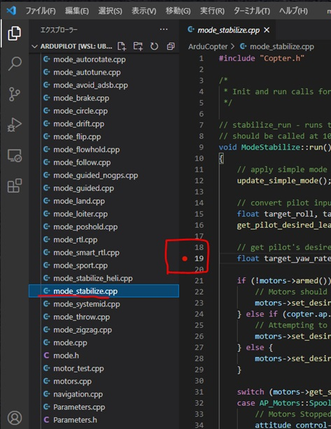  

<div style="page-break-before:always"></div>

## 10.4. Running the Debugger
From the Visual Studio Code terminal, run the following command just once.
You do not need to run it every time you debug. However, you need to run it again after a restart.  
```bash
echo 0 | sudo tee /proc/sys/kernel/yama/ptrace_scope
```

Next, start the simulator with the following command.  
```bash
sim_vehicle.py -v Copter --console --map -D -L Kawachi
```
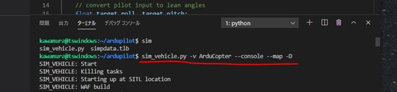  
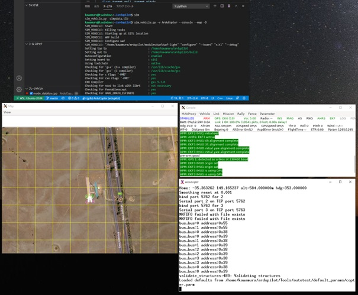  

Select `Run` → `Start Debugging` from the menu.  
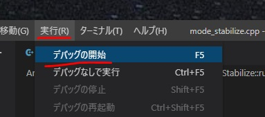  

Select the `arducopter` process.  
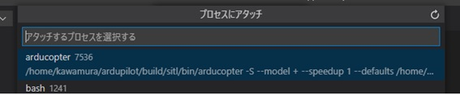  

The debugger attaches to the process, and the debug icon menu screen looks like the image.  
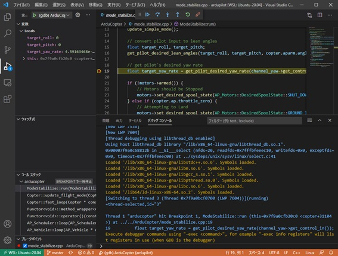  

If you want to learn about debugging with GDB, see the following.  
https://ardupilot.org/dev/docs/debugging-with-gdb-using-vscode.html

<div style="page-break-before:always"></div>

# 11. Appendix
## 11.1. Mission Planner
1. ArduPilot Wiki: [https://ardupilot.org/planner/](https://ardupilot.org/planner/)
## 11.2. Visual Studio Code
1. Keyboard shortcuts: [https://code.visualstudio.com/shortcuts/keyboard-shortcuts-windows.pdf](https://code.visualstudio.com/shortcuts/keyboard-shortcuts-windows.pdf)
## 11.3. MAVProxy
1. ArduPilot Wiki: [https://ardupilot.org/mavproxy/index.html](https://ardupilot.org/mavproxy/index.html)
## 11.4. Pymavlink
1. GitHub: [https://github.com/ArduPilot/pymavlink](https://github.com/ArduPilot/pymavlink)
2. Examples: [https://www.ardusub.com/developers/pymavlink.html](https://www.ardusub.com/developers/pymavlink.html)
